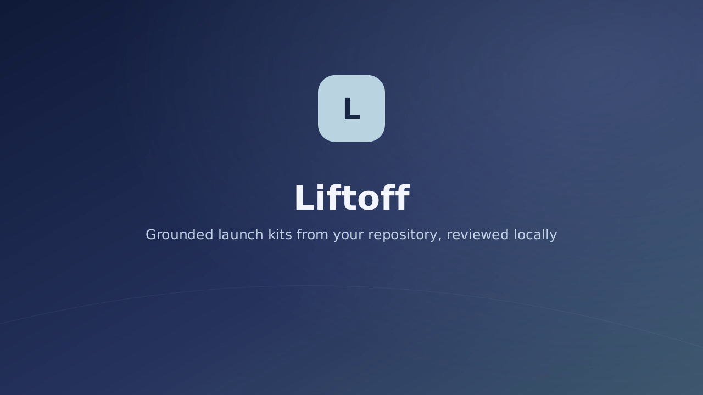
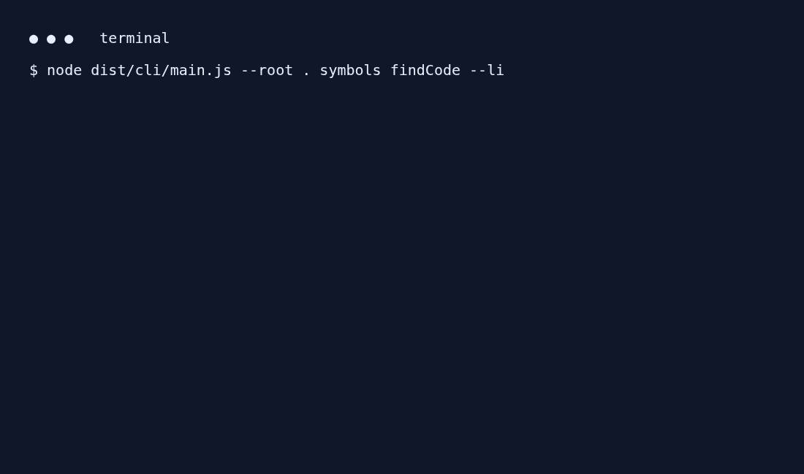
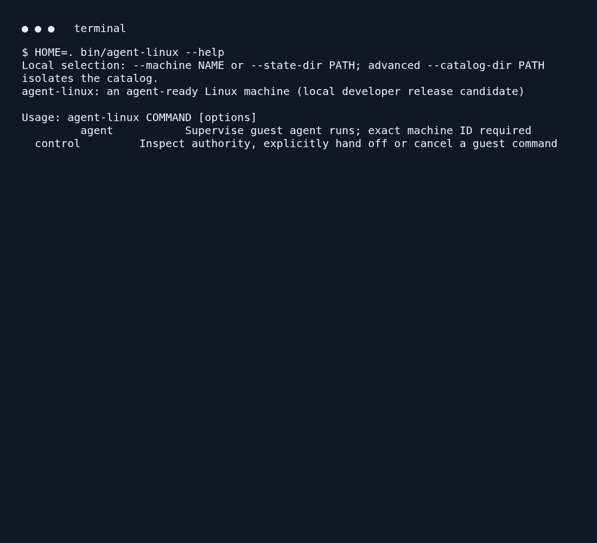

# Liftoff

## From real user complaints to a launched product, from your coding agent.

**Pain → product → assets → approval → posting → launch day → lessons. Run from your repo. Keep the receipts.**

Your agent knows what you built. Give it a workflow that asks what people need,
checks what the code can prove, captures the actual product, and puts you—not an
unattended bot—in charge of what goes public.

[](docs/demo/demo-16x9.mp4)

[Watch the demo](docs/demo/demo-16x9.mp4) · [Vertical cut](docs/demo/short-9x16.mp4) · [Square cut](docs/demo/square-1x1.mp4) · [Reproduce it](docs/demo/README.md)

The **57-second** self-demo ends with an approval refusal and an empty launch-day
view, not a pretend launch. Nothing was posted, staged or approved.

### The combination is the product

No single feature here is claimed to be unique. Keeping the evidence connected
across the workflow is the point. Here is what is implemented today:

| Piece | What you get—and the boundary |
| --- | --- |
| **Pain research feeds the copy** | Fetch and cache discussions; check quotes word for word against cached text. Product pains reference that research; writing briefs carry the community's words into pain-led openings. Your agent clusters evidence and writes posts. [Research](src/research/index.ts), [product checks](src/product/validate.ts), [writing briefs](src/copy/write.ts). |
| **Claims have a paper trail** | Feature and claim records require file, commit or URL sources. Local files are checked; unresolved commits warn. Copy citations connect sentences to evidence. Provenance is not proof that every sentence is true. [Validation](src/product/validate.ts), [copy checks](src/copy/check.ts). |
| **Capture, don't conjure** | Capture a running web app or real terminal commands, then build images and captioned video from those assets. No invented product UI. [Capture](src/commands/shots.ts), [media guide](skill/references/phase3.md). |
| **One approval page, exact hashes** | Review posts, sources and media locally. Approval binds the exact post-and-media hash; edits require re-approval before staging or assisted publishing. [Review](src/review/page.ts), [approval gate](src/review/approvals.ts). |
| **A launch-day desk** | `warroom` combines post status, reported counts, new comments and local reply drafts. Replies are human-paste only. **Incident monitoring, site-health checks and automatic post pausing are not implemented in this view.** [Warroom](src/launch-ops/warroom.ts). |
| **Memory for the next launch** | `learn` saves profile-specific observations; `plan` loads lessons that can change later time slots. `retro` compares reported results with targets. Not a promise of better results. [History](src/results/history.ts), [planning](src/planning/plan.ts), [retrospective](src/results/retro.ts). |

## Why not just ask for a launch post?

Because the hard part isn't another paragraph. It's the gap between “sounds good”
and “we can stand behind this.” A catchy claim without a source. A beautiful
mockup of a screen that doesn't exist. A last-minute edit nobody approved.

Liftoff gives your agent a folder contract, channel rules and checks. The agent
supplies judgment and copy; the CLI validates, captures, renders and assembles.
It does not build your product or call an LLM to write your launch.

## Proof you can open

These are committed artifacts from real local runs, **not successful public
launches**. Both showcase products belong to Aditya. Neither was launched by these
runs; there are no launch outcomes to report.

### GroundWork: show the lookup, not a promise



A real symbol lookup against GroundWork's own indexed source, followed by checked
drafts, social assets and a **33-second** terminal walkthrough. The verifier scene
shows command help, not a verifier run. The operator still wrote product facts,
posts and shot directions. Pain research was not fetched.

[Browse the kit](showcase/groundwork/README.md) · [Watch the square video](showcase/groundwork/video/square-1x1.mp4) · [Case study and limits](docs/case-studies/groundwork.md)

### Agent Linux: say what actually ran



The CLI was built on Linux; captures show help output. No Mac VM was booted and
no guest agent ran. That boundary belongs in the launch kit, not the fine print.

[Browse the kit](showcase/agentlinux/README.md) · [Watch the square video](showcase/agentlinux/video/square-1x1.mp4) · [Case study](docs/case-studies/agentlinux.md)

Clone the repo to open the included review HTML locally; GitHub shows HTML source,
not the approval interface. Exported pages are inspection copies, not permission
to publish. See the [showcase submission rules](showcase/README.md) to contribute
your own authorized kit and real results.

### A benchmark without a made-up victory

[LaunchBench](bench/launchbench/README.md) provides a blind human-comparison protocol
for **20** public open-source products, comparing Liftoff-assisted and plain-model
Show HN/X drafts. **Win rate: not yet measured; human votes pending.** The committed
files contain the product list and protocol, not votes or winning posts.

## Where Liftoff fits

Different tools solve different parts of launch. This is a scope comparison, not
a quality ranking. “Not documented” means the linked description does not establish
that capability—not that the tool could never do it. External products can change.

| Tool | What it is good for | Boundary relative to this workflow |
| --- | --- | --- |
| **Liftoff** | Research-linked briefs, repository-grounded facts, captured assets, hash-bound review, local staging, reply drafts and learned scheduling. | Agent/human input required. No demonstrated public launch outcomes here; no incident-triggered pause system. Publishing limits below. |
| [Ship Plainly](https://peerlist.io/markafan_dev/project/ship-plainly) | Product Hunt, Show HN, X and Reddit drafts checked against platform rules. | The described focus is compliant drafts; a repo-to-capture-to-hash-approval-to-lessons chain is not documented. |
| [Agentic Product Launch](https://www.producthunt.com/posts/1191555) | Community mapping, refusal of vote-request/spam tactics, a reply bank and recap. | Useful launch coordination; code-linked claims, real-app capture and exact-media hash approval are not established by that description. |
| [aaron-marketing-skills: launch-monitor](https://claudeskills.info/skills/aaron-he-zhu/aaron-marketing-skills/launch-monitor/) | Tracking HN rank, Product Hunt votes and store charts against targets. | Monitoring is its focus, not the upstream evidence/asset/review chain. Liftoff's warroom is not a replacement for all of that tracking. |
| [marketingskills: launch](https://claudeskills.info/skills/coreyhaines31/marketingskills/launch/) | Launch strategy and planning guidance. | A strategy skill, not a documented capture/render/hash-approval runtime. Can complement Liftoff. |
| [Ayrshare](https://www.ayrshare.com/), [Postiz](https://postiz.com/), [Buffer](https://buffer.com/) | Social publishing and scheduling infrastructure. | Delivery does not itself establish research-backed facts or source-captured assets. Liftoff's Postiz/Buffer routes only stage locally today. |
| [Official Product Hunt MCP](https://www.producthunt.com/mcp/install?client=claude) and [X MCP](https://docs.x.com/tools/mcp) | Platform-native agent access; capabilities depend on the platform, account and available tools. | Platform access is not the whole launch workflow. Liftoff restricts its own use: PH draft/readiness/preview only; X discovery with manual fallback. |

## Try it before connecting anything

Requirements: **Node.js 22+**, npm and git. For full media production, install
Chrome/Chromium and FFmpeg/ffprobe. Playwright is a package dependency; `doctor`
reports browser/tool availability. Tesseract is needed for storyboard safety
checks. VHS is optional; if installed, it also needs ttyd.
See the [media guide](skill/references/phase3.md).

```sh
# Add the agent skill; select liftoff when prompted.
npx skills add ADITYADEV4145/LaunchAnything
npm i -g launch-liftoff
liftoff setup
liftoff doctor
liftoff demo --open
```

`demo` creates a fresh sample repository and opens its local review page. It uses
prepared fixture copy, not research about your product. No accounts, network
requests, LLM calls or publishing. Missing Chrome/FFmpeg skips their assets with
a note. Use `--dir ./my-demo` to choose a directory that does not exist.

### Bring your own repo

Run inside your product repository. Have your agent follow the
[skill](skill/SKILL.md) and [product manifest guide](skill/references/product-json.md):

```sh
liftoff init
liftoff scan
liftoff research "the problem your product addresses"
# Agent: cluster cached evidence into .launch/research/pains.json.
liftoff research check
liftoff research report
# Agent: write .launch/product.json from code and checked evidence.
liftoff validate product
liftoff plan
liftoff brief
liftoff write
# Agent: write actual posts from the generated writing briefs.
liftoff check
liftoff shots plan
# Review/edit shots.yaml: real routes or commands; replace every TODO.
liftoff shots
liftoff images
liftoff video script --from-shots
liftoff video --renderer ffmpeg
liftoff review
# Human: approve exact post + media hashes in the local review page.
liftoff publish --dry-run
```

Research fetch uses network sources; source access and credentials can limit
availability. The CLI does not invent missing evidence. For a running web app,
use `shots --url http://127.0.0.1:3000`; CLI products use reviewed terminal commands.
This is collaboration, not a promise of finished copy without edits.

### What “publish” actually means today

- Default / `--dry-run`: no-network preview, still subject to approval checks.
- `--confirm`: writes local paste files, reminders and receipts. It does **not** send posts.
- `--confirm --assist`: explicitly opts into connected-account help. Browser routes
  fill forms; **you press Submit**. Product Hunt MCP supports draft/readiness/preview,
  never submission. X MCP discovers capabilities and falls back to manual delivery
  when no verified official create tool is available.
- LinkedIn uses official API routes only: Liftoff stages an offline request, not
  website automation or a live API post. Direct API, Postiz and Buffer routes also
  remain offline staging. Never auto-post to Hacker News or Reddit; never auto-reply.

Read the [own-account guide](skill/references/phase5b.md),
[adapter guide](skill/references/phase5c.md) and [channel guides](docs/channels/README.md)
before connecting accounts. Local audience/waitlist previews and signup CSV export
exist; they do not host a waitlist or send outreach.

## Keep going after the launch

| Job | Commands |
| --- | --- |
| Find people and prepare | `communities fetch`, `communities report`, `communities check`, `audience prepare`, `prelaunch` |
| Plan and write | `recommend`, `plan`, `brief`, `write`, `check`, `judge`, `pick` |
| Make and inspect assets | `shots`, `shots export`, `images`, `media polish`, `media judge`, `video script`, `video`, `video check` |
| Review and deliver | `review`, `connect`, `adapters`, `publish` |
| Launch-day follow-through | `warroom --metrics <file>`, `results --replies`, `followup` |
| Remember and relaunch | `learn`, `retro`, `receipt`, `release --draft`, `progress` |
| Check the environment | `setup`, `doctor`, `selftest`, `estimate`, `telemetry status` |

Use `liftoff --help` and `liftoff <command> --help` for the complete interface.
Global `--cwd <repository>` selects a repo; `--json` returns one result object.
See [launch operations](skill/references/launch-ops.md) for release kits and
follow-through. `release --draft` and `progress` make review-only drafts, not posts.

## Local by default. Human at the boundary.

Launch state lives in `.launch/`: product facts, plans, posts, media, review,
approvals and results. Profile history lives in `~/.liftoff/history.json`.
Core scanning and kit assembly need no server, database or LLM API. Explicit
research, connection and optional voice operations can use the network.
Telemetry is off by default; opting in records allowlisted local events only,
with nothing uploaded. Never commit tokens, private research or approval credentials.

## Contribute

```sh
npm ci
npm run dev -- doctor
npm run build
npm run typecheck
npm test
node dist/cli.js selftest --through 6 --json   # baseline launch workflow
node dist/cli.js selftest --through B --json   # every phase, including media and recommend
```

See [contributor ownership and fixture guidance](CONTRIBUTING/AGENTS.md)
and the [skill reference index](skill/references/README.md).
Bring reproducible artifacts, honest limits and permission to share them.

[MIT licensed](LICENSE). Built by Aditya.
